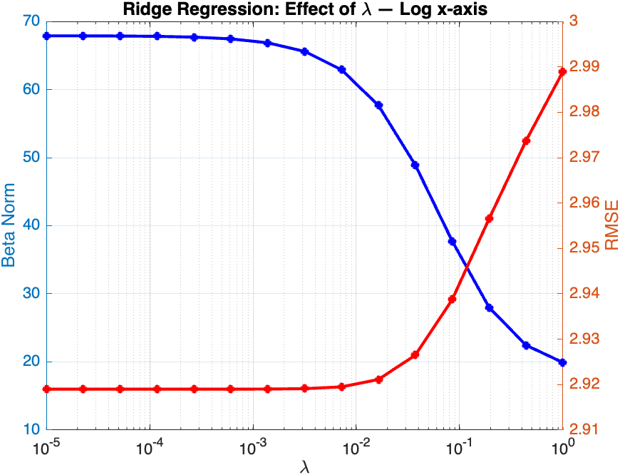
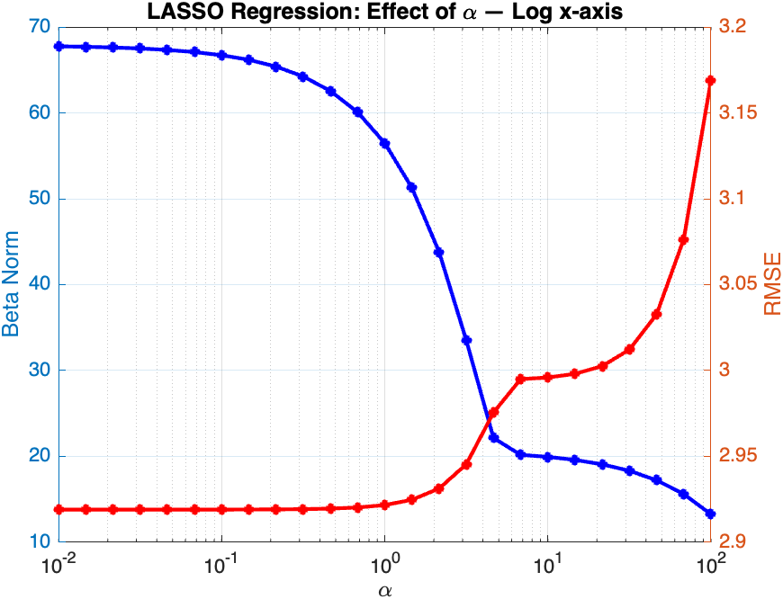
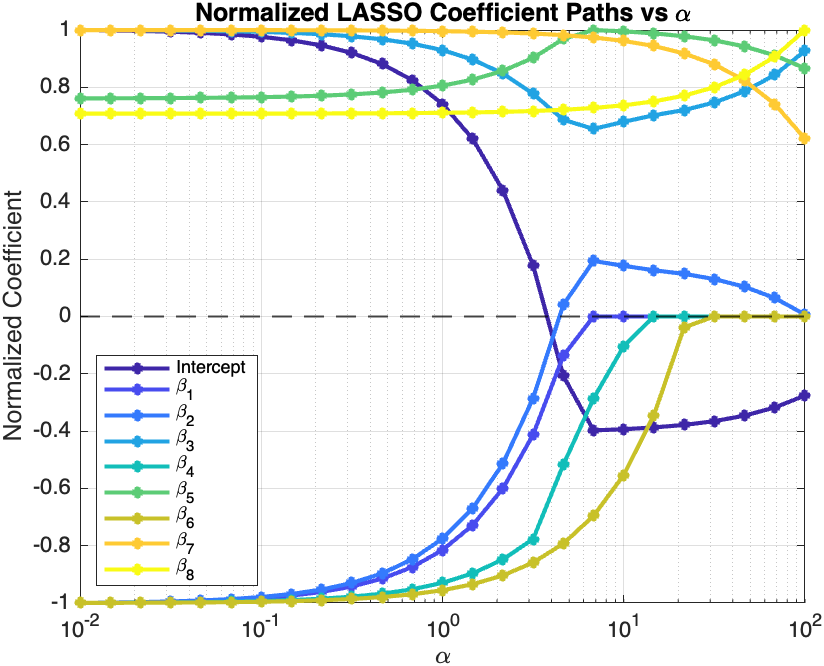
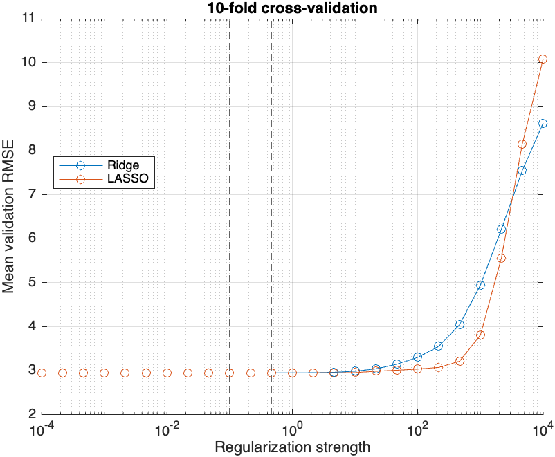
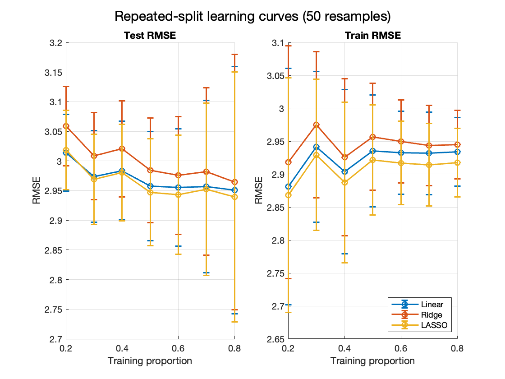

# Documentation

## Introduction

The UCI Energy Efficiency dataset is a Machine Learning dataset that contains 8 physical features about a building, as well as 2 targets (Heating Load and Cooling Load). It contains 768 samples, which makes it useful as a toy problem or to test modelling methods. Various incremental modelling techniques will be applied to obtain linear models, and then improve them to get simpler models that retain the key information, using techniques such as Ridge, LASSO or PCA.

## Linear regression

The simplest model is linear regression on a single target feature. Let the target feature be modelled as $\vec{y}=\beta^T X$, we want the vector $\beta$ that minimizes cuadratic error over the samples in $X$. Thus, the function to minimize is

$$
J(\beta)=\frac{1}{2}(y^T-X\beta)(y-X\beta)=\frac{1}{2}(y^Ty-2\beta^TX^Ty+\beta^TX^TX\beta)
$$

By setting the gradient with respect to $\beta$ equal to 0, we get

$$
-X^Ty+X^TX\beta=0\implies X^TX\beta=X^Ty
$$

Thus, the algebraic solution to linear regression is

$$
\beta = (X^TX)^{-1}X^Ty
$$

Furthermore, as calculating inverses can be computationally expensive, QR factorization can be used. Let $X=QR$, where $Q^T=Q^{-1}$. Then,

$$
\beta = (X^TX)^{-1}X^Ty = \left((QR)^T(QR)\right)^{-1}(QR)^Ty = \left(R^TQ^TQR\right)^{-1}R^TQ^Ty
$$

Since $Q^TQ=I$, this simplifies to

$$
\beta = (R^TR)^{-1}R^TQ^Ty = R^{-1}(R^T)^{-1}R^TQ^Ty = R^{-1}Q^Ty
$$

Therefore, instead of explicitly computing $(X^TX)^{-1}$, the regression coefficients can be obtained by solving the triangular system

$$
R\beta = Q^Ty.
$$

This approach is computationally more efficient and numerically more stable than directly computing the inverse of $X^TX$.

### Numerical implementation

On the [`Linear_Regression.mlx`](../MATLAB/Linear_Regression.mlx) notebook, this method is implemented on the UCI Energy Efficiency dataset. However, the resulting matrix is ill-conditioned, due to multicollinearity between the variables. Nonetheless, Matlab achieves a RMSE of $3.0050$. Using the QR factorization improves the numerical stability, leading to a RMSE of $2.9190$. However, one of the coefficients is exactly zero, suggesting this variable is a linear combination of the others. As a matter of fact, removing it mantains the RMSE, whereas removing more variables then increases the RMSE. However, this process that has been done manually of removing features to improve the model, motivates the search for methods that not only minimize the quadratic error, but rather penalize complex models that do not significantly improve estimations, methods such as Ridge or LASSO.

## Regression penalties

This prodcedure of finding whch variables have the lowest contribution and removing them motivates the use of regularitazion techniques. These techniques modify the target function (currently quadratic error) to account for other factors that might lead to more desirable models. The new error function will be

$$
J(\beta)=\|y- X\beta\| + \lambda\|\beta\|
$$

for some arbitrary metrics. Generally, quatratic erorrs will be used, and in this repository, only $l_1$ and $l_2$ penalties will be explored. By minimizing

$$
J(\beta)=\|y-X\beta\|_2^2+\lambda \|\beta\|_2^2,\quad\lambda\in\mathbb{R}
$$

Ridge regression is obtained, where $\lambda$ controls the regularization strength. If instead, the $l_1$ metric is used (sum of absolute values), LASSO regularization will be found, with general expression

$$
J(\beta)=\|y-X\beta\|_2^2+\lambda \|\beta\|_1,\quad\lambda\in\mathbb{R}
$$

### Analytical solution for Ridge

$$
J(\beta)=(y-X\beta)^T(y-X\beta)+\lambda\beta^T\beta= y^Ty-2\beta^TX^Ty+\beta^TX^TX\beta+\lambda\beta^T\beta
$$

The partial derivative will be

$$
\frac{\partial}{\partial\beta}J=-2X^Ty+2X^TX\beta+2\lambda\beta=0
$$

in the minimum. This is equivalent to

$$
(X^TX+\lambda I)\beta=X^Ty\implies \beta = (X^TX+\lambda I)^{-1}X^Ty
$$

which is the analytical solution to Ridge regression. Intuitively, increasing the elements in the diagonal makes the matrix more positively definite, which reduces the risk of the matrix being singular.

### Ridge numerical implementation

On the [`Ridge_Regression.mlx`](../MATLAB/Ridge_Regression.mlx) notebook, the analytical solution is implemented. By varying the regularization strength, increasingly simpler models that retain comparably small erorrs can be obtained. However, it gets to a point where error starts to increase faster, making it less worth it to keep making simpler models.

### LASSO penalty

If the $l_1$ norm is used as a penalty instead, LASSO regression is obtained. Its expression is the following.

$$
J(\beta)=\|y-X\beta\|_2^2+\alpha \|\beta\|_1^2,\quad\alpha\in\mathbb{R}
$$

For this method, there is no closed form solution, but it can be easily implemented using coordinate descent.

### LASSO numerical implementation

As with Ridge, LASSO allows for a substantial decrease in the coefficients vector norm, while retaining similar RMSE. As regularization increases, fitting becomes worse. It can also be noted how, due to the absolute value not being derivable at $0$, the smooth behavior of the quadratic norm used in Ridge is lost in LASSO, which eventually clamps coefficients to 0, but has less smooth convergence. The effect of regularization strength on both RMSE and coefficient magnitudes can be seen in the following plots.

## K-fold tuning

The [`KFold_Tuning.mlx`](../MATLAB/KFold_Tuning.mlx) notebook focuses on the problem of hyperparameter selection for regularized models. In Ridge and LASSO, the parameter controlling model complexity ($\lambda$ or $\alpha$) affects the bias-variance tradeoff: very small values can lead to overfitting and unstable predictions, while very large values can oversimplify the model and increase error. Selecting a single train/test split is often misleading because the result depends strongly on which observations happen to fall into the training or validation set.

K-fold cross-validation addresses this by partitioning the data into $K$ disjoint subsets, or folds. The procedure is:

1. Split the dataset into $K$ folds.
2. For each fold, train the model on the remaining $K-1$ folds.
3. Evaluate the model on the held-out fold using a performance metric such as RMSE.
4. Repeat this process for every fold.
5. Average the validation errors to obtain a robust estimate of the model performance for that regularization value.
6. Repeat the whole process across a grid of candidate regularization strengths and choose the value with the lowest mean validation error.

Mathematically, for a fixed regularization parameter $\lambda$, the cross-validation score is

$$
\mathrm{CV}(\lambda)=\frac{1}{K}\sum_{k=1}^{K}\mathrm{RMSE}_k(\lambda),
$$

where $\mathrm{RMSE}_k(\lambda)$ is the root mean squared error measured on fold $k$ after training on the remaining folds. This average reduces the variance of the estimator compared with a single split and provides a more stable basis for model selection.

In practice, this makes the tuning step more reliable: instead of fitting a model on one arbitrary split and trusting that result, the algorithm checks how well each value of $\lambda$ generalizes across several partitions of the same data. Once the best parameter is chosen, the final model can be refit on the full training data and then evaluated on a separate final test set if desired.

The result of this tuning process on the UCI Energy Efficiency dataset is shown below. The plot summarizes the cross-validation error across candidate regularization values and highlights the range where the model performs best.

For this specific dataset, the optimal parameters found are $\lambda = 0.1$ for Ridge and $\alpha = 0.46415$ for LASSO.

## Learning curves for the methods

The [`Learninc_curves.mlx`](../MATLAB/Learning_curves.mlx) notebook evaluates each model over the same set of sample fractions, using multiple random train/test splits and various proportions, and reports mean RMSE with standard deviation. This allows for the bias-variance tradeoff is visible. The optimal parameters for $\alpha$ and $\lambda$ found above are used.

The learning curves demonstrate that increasing the training proportion consistently improves model generalization, as seen by the steady decrease in Test RMSE across all models. Notably, Train RMSE exhibits a slight upward trend as training data increases; this is a classic statistical phenomenon where larger, more varied datasets prevent the model from perfectly memorizing the training samples, thereby reducing variance and improving performance on unseen data. Among the models, Ridge performs the poorest with consistently high error, while Linear and LASSO perform similarly, with LASSO achieving the lowest test error at higher training proportions.

These results illustrate the bias-variance tradeoff: at low training proportions, models suffer from high variance, fitting the small sample too closely but generalizing poorly. As the training proportion grows, the models shift toward lower variance and reduced bias, closing the gap between training and test error. The convergence of the curves at higher proportions indicates that adding more data yields diminishing returns, and the model has learned a robust underlying pattern rather than noise.
